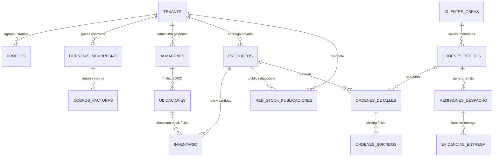

# 🏛️ VERTIA & InvenTrack v2 - Documento de Entidades y Modelo de Datos

Este documento define la arquitectura integral de base de datos para la plataforma **VERTIA** y el software de gestión de depósitos **InvenTrack v2**. El modelo está estructurado bajo **PostgreSQL 15+ (Supabase)** utilizando aislamiento estricto multi-inquilino (*Multi-Tenant*) mediante **Row Level Security (RLS)**.

---

## 📐 1. Arquitectura de las 3 Capas de Entidades

El ecosistema desacopla formalmente las responsabilidades en tres capas de datos:

1. **Capa 1: VERTIA Central (Operador de Red y Meta-Admin):**
   - Control de organizaciones (*tenants*), planes, cobros, bonificaciones comerciales, habilitación de licencias InvenTrack y cartelera de la Red B2B.
2. **Capa 2: Proveedor de Materiales (Corralón / InvenTrack WMS):**
   - Manejo interno del depósito: almacenes físicos, zonas de recepción/embarque, matriz de pasillos/racks/niveles, inventario por lote, picking guiado y remisiones.
3. **Capa 3: Cliente Solicitante (Constructora / Contratista / Obra):**
   - Proyectos de obra, solicitudes de materiales, seguimiento de camiones en viaje y recepción con firma/evidencia fotográfica.

---

## 🗄️ 2. Diccionario Detallado de Entidades por Capa

### CAPA 1: VERTIA CENTRAL (Operador de Red & Meta-Admin)

#### 1.1 `tenants` (Empresas y Organizaciones)
Representa a toda entidad jurídica registrada en la red (Corralones, Constructoras, Canteras).
- **`id`** (`UUID`, PK): Identificador único de la organización.
- **`nombre`** (`TEXT`): Razón social o nombre comercial.
- **`slug`** (`TEXT`, UNIQUE): Identificador amigable para subdominio o URLs.
- **`cuit_rut_taxid`** (`TEXT`): Identificación tributaria fiscal.
- **`tipo_empresa`** (`TEXT`): `'corralon'` (proveedor con stock), `'constructora'` (cliente comprador), `'servicios'` (contratista).
- **`habilitado_inventrack`** (`BOOLEAN`): Bandera maestra de licencia. Si es `FALSE`, la empresa no puede acceder al software WMS.
- **`radio_cobertura_km`** (`INT`): Radio logístico de despacho (ej. 30 km).
- **`plan`** (`TEXT`): `'free'`, `'pro'`, `'enterprise'`, `'obras'`.
- **`activo`** (`BOOLEAN`): Estado general de la cuenta.
- **`created_at`** (`TIMESTAMPTZ`): Fecha de alta.

#### 1.2 `profiles` (Usuarios del Sistema)
Extensión del servicio `auth.users` de Supabase.
- **`id`** (`UUID`, PK): Clave foránea a `auth.users.id`.
- **`email`** (`TEXT`): Correo corporativo del usuario.
- **`nombre_completo`** (`TEXT`): Nombre y apellido.
- **`avatar_url`** (`TEXT`): Fotografía de perfil.
- **`is_super_admin`** (`BOOLEAN`): Si es `TRUE`, tiene privilegios de Operador de Plataforma Vertia (Humberto / Federico).

#### 1.3 `tenant_users` (Roles y Membresías por Empresa)
Define qué rol ocupa un usuario dentro de un tenant específico.
- **`id`** (`UUID`, PK): Identificador único.
- **`tenant_id`** (`UUID`, FK `tenants.id`): Organización a la que pertenece.
- **`user_id`** (`UUID`, FK `profiles.id`): Usuario asignado.
- **`rol`** (`app_role` ENUM):
  - `'administrador'`: Dueño o gerente del corralón/empresa.
  - `'responsable_inventario'`: Jefe de galpón y stock.
  - `'receptor_mercaderia'`: Operario de muelles de entrada.
  - `'responsable_embarques'`: Operario de picking y despacho.
  - `'guardia'`: Control de accesos y portón.
  - `'cliente'`: Encargado de compras o director de obra.
- **`activo`** (`BOOLEAN`): Si el usuario está habilitado en este tenant.

#### 1.4 `licencias_membresias` (Contratos y Tarifas Vertia)
Control contable de la relación comercial entre Vertia y cada empresa.
- **`id`** (`UUID`, PK)
- **`tenant_id`** (`UUID`, FK `tenants.id`)
- **`precio_base_mensual`** (`NUMERIC(12,2)`): Tarifa plena de lista (ej. $49 USD o $129 USD).
- **`descuento_porcentaje`** (`NUMERIC(5,2)`): Porcentaje de bonificación comercial (ej. 20%).
- **`motivo_bonificacion`** (`TEXT`): Motivo comercial registrado por el operador de Vertia (ej. "Convenio Cámara de la Construcción", "Prueba Piloto 60 días").
- **`precio_final_mrr`** (`NUMERIC(12,2)`): Cómputo contable simple: $\text{Base} \times (1 - \frac{\text{Descuento}}{100})$.
- **`fecha_vencimiento`** (`DATE`)
- **`estado`** (`TEXT`): `'Activa'`, `'Prueba Gratuita'`, `'Suspendida'`, `'Anulada'`.

#### 1.5 `cobros_facturacion` (Movimientos Contables Simples)
- **`id`** (`UUID`, PK)
- **`tenant_id`** (`UUID`, FK `tenants.id`)
- **`periodo`** (`TEXT`): ej. `'2026-11'`.
- **`monto_bruto`** (`NUMERIC(12,2)`)
- **`monto_bonificado`** (`NUMERIC(12,2)`)
- **`monto_neto_cobrado`** (`NUMERIC(12,2)`)
- **`estado_pago`** (`TEXT`): `'Al día'`, `'Pendiente'`, `'Vencido'`.
- **`fecha_pago`** (`TIMESTAMPTZ`, NULLABLE)

---

### CAPA 2: PROVEEDOR DE MATERIALES (Corralón / InvenTrack WMS)

#### 2.1 `almacenes` (Depósitos Físicos)
- **`id`** (`UUID`, PK)
- **`tenant_id`** (`UUID`, FK `tenants.id`): Aislamiento multi-tenant.
- **`nombre_almacen`** (`TEXT`): ej. "Galpón Central Oeste".
- **`es_zona_recepcion`** (`BOOLEAN`): Si actúa como pulmón de descarga/ingreso de proveedores.
- **`es_zona_embarque`** (`BOOLEAN`): Si actúa como pulmón de staging/salida para camiones de despacho.
- **`capacidad_maxima`** (`NUMERIC`)
- **`coordenadas_gps`** (`TEXT`)
- **`activo`** (`BOOLEAN`)

#### 2.2 `ubicaciones` (Matriz Espacial de Almacenamiento 2D / 3D)
- **`id`** (`UUID`, PK)
- **`tenant_id`** (`UUID`, FK `tenants.id`)
- **`almacen_id`** (`UUID`, FK `almacenes.id`)
- **`fila`** (`INT`): Pasillo de circulación.
- **`rack`** (`INT`): Estructura o módulo.
- **`estanteria`** (`INT`): Bahía vertical.
- **`nivel`** (`INT`): Piso de altura (1=suelo/picking, 2=media carga, 3=pallets superiores).
- **`caja`** (`INT`) / **`interior`** (`INT`)
- **`codigo_visual`** (`TEXT`): Etiqueta física para operarios (ej. `PAS-1-R02-N1`).

#### 2.3 `productos` (Catálogo Privado de Materiales)
- **`id`** (`UUID`, PK)
- **`tenant_id`** (`UUID`, FK `tenants.id`): Propiedad exclusiva del corralón.
- **`codigo_barras`** (`TEXT`): Código EAN/SKU.
- **`nombre`** (`TEXT`): Denominación del material (ej. "Cemento Loma Negra 50kg").
- **`categoria`** (`TEXT`): "Obra Gruesa", "Áridos", "Aceros y Hierros", etc.
- **`unidad_medida`** (`TEXT`): "BL" (bolsa), "M3" (metro cúbico), "UN" (barra/unidad).
- **`precio`** (`NUMERIC(14,2)`): Precio de venta local.
- **`cantidad_minima`** (`INT`): Punto de pedido / alerta de stock mínimo.
- **`publicado_en_red`** (`BOOLEAN`): Interruptor B2B. Si es `TRUE`, se visualiza en la cartelera de Vertia.
- **`activo`** (`BOOLEAN`)

#### 2.4 `inventario` (Stock Real Físico por Celda y Lote)
- **`id`** (`UUID`, PK)
- **`tenant_id`** (`UUID`, FK `tenants.id`)
- **`almacen_id`** (`UUID`, FK `almacenes.id`)
- **`ubicacion_id`** (`UUID`, FK `ubicaciones.id`)
- **`producto_id`** (`UUID`, FK `productos.id`)
- **`lote`** (`TEXT`): Identificador de partida/fabricación.
- **`cantidad`** (`INT`): **Stock Real Físico** existente en la celda.
- **`fecha_vencimiento`** (`DATE`, NULLABLE)

> [!IMPORTANT]
> **Invariante Matemático de Dual Stock:**  
> $\text{Stock Disponible} = \text{Stock Real} - \text{Stock Comprometido}$.  
> El **Stock Real** reside físicamente en la suma de celdas de `inventario`. El **Stock Comprometido** es la suma de ítems en órdenes activas en preparación. El **Stock Disponible** es el saldo negociable en mostrador o red. Solo el **Administrador del Corralón** puede habilitar extensiones o modificar el stock disponible.

#### 2.5 `movimientos` (Kardex y Trazabilidad de Auditoría)
- **`id`** (`UUID`, PK)
- **`tenant_id`** (`UUID`, FK `tenants.id`)
- **`producto_id`** (`UUID`, FK `productos.id`)
- **`tipo_movimiento`** (`tipo_movimiento_stock` ENUM): `'entrada'`, `'reubicacion'`, `'salida'`, `'ajuste_positivo'`, `'ajuste_negativo'`, `'surtido'`.
- **`cantidad`** (`INT`)
- **`lote`** (`TEXT`)
- **`ubicacion_origen_id`** (`UUID`, FK `ubicaciones.id`, NULLABLE)
- **`ubicacion_destino_id`** (`UUID`, FK `ubicaciones.id`, NULLABLE)
- **`usuario_id`** (`UUID`, FK `profiles.id`): Operario que ejecutó la acción.
- **`motivo`** (`TEXT`)
- **`created_at`** (`TIMESTAMPTZ`)

#### 2.6 `remisiones` y `remisiones_detalles` (Despacho Oficial)
- **`id`** (`UUID`, PK)
- **`tenant_id`** (`UUID`, FK `tenants.id`)
- **`numero_remito`** (`TEXT`): Folio legal preimpreso o digital (ej. `REM-2026-0042`).
- **`orden_id`** (`UUID`, FK `ordenes_suministro.id`)
- **`chofer_nombre`** (`TEXT`)
- **`chofer_dni`** (`TEXT`)
- **`patente_vehiculo`** (`TEXT`)
- **`fecha_despacho`** (`TIMESTAMPTZ`)
- **`archivo_pdf_url`** (`TEXT`): Enlace al remito renderizado.

---

### CAPA 3: CLIENTE / CONSTRUCTORA & RED B2B

#### 3.1 `clientes_obras` (Clientes Finales y Frentes de Obra)
- **`id`** (`UUID`, PK)
- **`tenant_id_cliente`** (`UUID`, FK `tenants.id`): Constructora propietaria de la obra.
- **`nombre_obra`** (`TEXT`): ej. "Edificio Torre Bellini Piso 14".
- **`direccion_obra`** (`TEXT`): Dirección exacta para entrega.
- **`contacto_receptor`** (`TEXT`): Nombre del capataz que recibe el camión.
- **`telefono_contacto`** (`TEXT`)
- **`coordenadas_gps`** (`TEXT`)

#### 3.2 `ordenes_suministro` y `ordenes_suministro_detalles` (Pedidos de Materiales)
- **`id`** (`UUID`, PK)
- **`folio`** (`TEXT`, UNIQUE): ej. `VT-2026-8841`.
- **`tenant_id_solicitante`** (`UUID`, FK `tenants.id`): Constructora.
- **`tenant_id_proveedor`** (`UUID`, FK `tenants.id`): Corralón asignado.
- **`obra_id`** (`UUID`, FK `clientes_obras.id`)
- **`estado`** (`TEXT`): `'Por cotizar'`, `'Asignada'`, `'En preparación'`, `'En camino'`, `'Entregada'`.
- **`fecha_solicitud`** (`TIMESTAMPTZ`)

#### 3.3 `red_stock_publicaciones` (Cartelera B2B de Excedentes)
- **`id`** (`UUID`, PK)
- **`tenant_id_ofertante`** (`UUID`, FK `tenants.id`): Corralón vendedor.
- **`producto_id`** (`UUID`, FK `productos.id`)
- **`cantidad_publicada`** (`INT`): Cupo de stock disponible ofrecido a la red.
- **`precio_unitario_red`** (`NUMERIC(14,2)`)
- **`radio_limite_km`** (`INT`)
- **`activo`** (`BOOLEAN`)

#### 3.4 `evidencias_entrega` (Validación Fotográfica de Remitos)
- **`id`** (`UUID`, PK)
- **`tenant_id`** (`UUID`, FK `tenants.id`)
- **`orden_id`** (`UUID`, FK `ordenes_suministro.id`)
- **`tipo`** (`TEXT`): `'Remito Firmado'`, `'Material en Obra'`, `'Descarga Camión'`.
- **`storage_path`** (`TEXT`): Ruta en Supabase Storage (bucket `evidencias`).
- **`peso_bytes_original`** (`INT`): ej. 4.800.000 (4.8 MB).
- **`peso_bytes_comprimido`** (`INT`): ej. 245.000 (~240 KB WebP).
- **`estado_validacion`** (`TEXT`): `'Pendiente'`, `'Validada'`, `'Ajuste solicitado'`.
- **`inspector_usuario_id`** (`UUID`, FK `profiles.id`)

---

## 🔒 3. Resumen de Políticas de Seguridad (RLS)

| Capa | Entidades | Acceso Permitido |
| :--- | :--- | :--- |
| **Super Admin / Operador Vertia** | `tenants`, `licencias`, `cobros`, `profiles` | Lectura y escritura total comercial. |
| **Super Admin / Operador Vertia** | `productos`, `almacenes`, `inventario` | **Solo Lectura (Modo Auditoría)**. Prohibido crear, alterar o borrar stock físico de un corralón. |
| **Administrador del Corralón** | `productos`, `inventario`, `ubicaciones`, `remisiones` | Lectura y escritura plena sobre su propio `tenant_id`. Control del stock disponible. |
| **Operario del Corralón** | `almacenes`, `inventario`, `picking`, `evidencias` | Lectura y actualización operativa de ubicaciones y picking. No puede modificar contratos comerciales. |
| **Cliente / Constructora** | `ordenes_suministro`, `clientes_obras`, `evidencias` | Solo lectura y alta de sus requerimientos propios. Sin visibilidad de la matriz interna de racks del corralón. |
